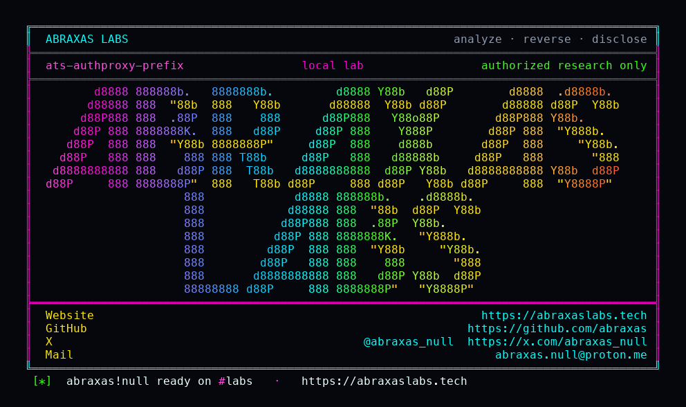

<p align="center">
  
</p>

<p align="center">
  <a href="https://abraxaslabs.tech"><strong>abraxaslabs.tech</strong></a>
  &nbsp;·&nbsp;
  <a href="https://github.com/abraxas">github.com/abraxas</a>
  &nbsp;·&nbsp;
  <a href="https://x.com/abraxas_null">@abraxas_null</a>
  &nbsp;·&nbsp;
  <a href="mailto:abraxas.null@proton.me">abraxas.null@proton.me</a>
  &nbsp;·&nbsp;
  <a href="https://github.com/abraxas/ats-authproxy-prefix">ats-authproxy-prefix</a>
</p>

# ats-authproxy-prefix

**Class:** Privilege leftover
**Reach:** Remote

**Apache Traffic Server** `10.2.0` (`b1df7334`) - Apache Software Foundation

authproxy `--forward-header-prefix` copies identity fields from a 2xx auth helper onto the client request. `HttpSetMimeHeader` finds and overwrites only the **first** field of that name. Extra client copies survive. An origin that last-wins the same header treats the client value as identity.

Stock `plugin.config` is empty. This leftover needs the plugin on a remap with the prefix option. The client still has to pass auth (2xx). Auth 403 never reaches origin.

| | |
|---|---|
| ID | no CVE yet |
| Class | **Privilege leftover** (identity header plant) |
| Reach | **Remote** (HTTP through authproxy with `--forward-header-prefix`) |
| CWE | [CWE-444](https://cwe.mitre.org/data/definitions/444.html), [CWE-863](https://cwe.mitre.org/data/definitions/863.html) |
| CVSS | **High: 8.1** `CVSS:3.1/AV:N/AC:H/PR:N/UI:N/S:U/C:H/I:H/A:H` |
| Product | [Apache Traffic Server](https://github.com/apache/trafficserver) |
| Affected | **10.2.0** (`b1df7334b39a878971c376da849e8da4984918b6`) authproxy prefix overlay |
| Auth | client who already gets a 2xx from the auth helper. Plugin on. |
| License | [GNU Affero GPL v3.0](LICENSE) |
| Lab | `127.0.0.1:18760` only |

I pinned public tag [10.2.0](https://github.com/apache/trafficserver/releases/tag/10.2.0) peel [b1df7334](https://github.com/apache/trafficserver/commit/b1df7334b39a878971c376da849e8da4984918b6). The lab is a source-built `ats-10.2.0-lab:local` reverse proxy on loopback. Auth helper 2xx vs 403. Origin last-wins `X-Auth-User`.

## What an attacker can do

Reach an ATS remap that loads `authproxy.so` with `--forward-header-prefix=X-Auth-`. Send two `X-Auth-User` lines on a request the helper accepts as 2xx.

| Method | Sink | Privilege |
|---|---|---|
| Duplicate `X-Auth-User` after a 2xx auth helper | `StateAuthorized` overlay then `HttpSetMimeHeader` ([`authproxy.cc:660-690`](https://github.com/apache/trafficserver/blob/b1df7334b39a878971c376da849e8da4984918b6/plugins/authproxy/authproxy.cc#L660-L690), [`utils.cc:87-102`](https://github.com/apache/trafficserver/blob/b1df7334b39a878971c376da849e8da4984918b6/plugins/authproxy/utils.cc#L87-L102)) | **Integrity (lab-proven):** origin last-wins. Lab: `X-Auth-User-0: realuser` plus `X-Auth-User-1: ATS-AUTHPROXY-PREFIX-WITNESS`. CONTROL none/single stay `REALUSER-ONLY`. |
| Same plant | origin ACL / user lookup keyed on that header | **Recon (inferred):** whatever that planted identity can read at origin. Not a heap dump. Not ATS config. |
| Auth helper 403 with the same duplicates | `StateUnauthorized`; origin not reenabled | **Closed (lab-proven):** origin hits unchanged. Client 403. Witness not in the body. |

**Lab-proven vs inferred:** duplicate last-wins, single overwrite, none, and 403-not-reached are lab. Origin privilege after plant is inferred from last-wins identity.

**Requires:** `authproxy.so` with `--forward-header-prefix`. Client must pass auth (2xx). Origin must treat those prefix headers as identity (the reason the option exists). Not loaded in default `plugin.config`.

## Adjacent surface that stays closed

| Surface | Lab |
|---|---|
| No client prefix header | CONTROL none: origin `REALUSER-ONLY` |
| Single client prefix | CONTROL single: first field overwritten; witness does not survive |
| Auth helper 403 | origin not reached (`control-403=yes`) |
| Plugin not loaded | leftover does not apply |
| Hop-by-hop / `@` headers | stripped before plugin hooks (CVE-2026-33267) |
| Empty auth-response header list | no longer asserts (changelog) |
| certifier SNI / url_sig `C=` | closed on this pin (CVE-2026-58162 / 58181) |

Not CVE-2026-58162. SHA-256/SHA-512 only on uri_signing. url_sig `C=` missing delimiter still denies.

## Lab

```bash
python3 ats-authproxy-prefix-Abraxas-Labs.py
```

or

```bash
cd lab
./run.sh
```

Loopback `127.0.0.1:18760` (origin `18761`, auth helper `18762`). Compose project `ats-authproxy-prefix`. Image `ats-10.2.0-lab:local`. Witness `ATS-AUTHPROXY-PREFIX-WITNESS`. Last line:

```
SUCCESS ats-authproxy-prefix pin=10.2.0 control-none=REALUSER-ONLY control-single=REALUSER-ONLY control-403=yes dup-last-wins=yes ATS-AUTHPROXY-PREFIX-WITNESS
```

## The fix

Strip every client field whose name starts with `--forward-header-prefix` before overlay. `HttpRemoveMimeHeader` already walks `TSMimeHdrFieldFind` until none remain (`utils.cc:104-114`). Use it on the client request for the configured prefix, then set. Make `HttpSetMimeHeader` destroy `TSMimeHdrFieldNextDup` extras the way `origin_server_auth` `set_header` and access_control `setHeader` already do.

Until then, do not point origin ACL at authproxy prefix headers unless the origin first-wins, or reject duplicate prefix names at the origin.

## References

- [github.com/apache/trafficserver](https://github.com/apache/trafficserver) tag [10.2.0](https://github.com/apache/trafficserver/releases/tag/10.2.0) (`b1df7334b39a878971c376da849e8da4984918b6`)
- [`plugins/authproxy/authproxy.cc`](https://github.com/apache/trafficserver/blob/b1df7334b39a878971c376da849e8da4984918b6/plugins/authproxy/authproxy.cc) `StateAuthorized`
- [`plugins/authproxy/utils.cc`](https://github.com/apache/trafficserver/blob/b1df7334b39a878971c376da849e8da4984918b6/plugins/authproxy/utils.cc) `HttpSetMimeHeader` / `HttpRemoveMimeHeader`
- [authproxy admin guide](https://docs.trafficserver.apache.org/en/latest/admin-guide/plugins/authproxy.en.html)
- Contrast: [`origin_server_auth.cc`](https://github.com/apache/trafficserver/blob/b1df7334b39a878971c376da849e8da4984918b6/plugins/origin_server_auth/origin_server_auth.cc) `set_header` walks NextDup
- [CWE-444](https://cwe.mitre.org/data/definitions/444.html) · [CWE-863](https://cwe.mitre.org/data/definitions/863.html)
